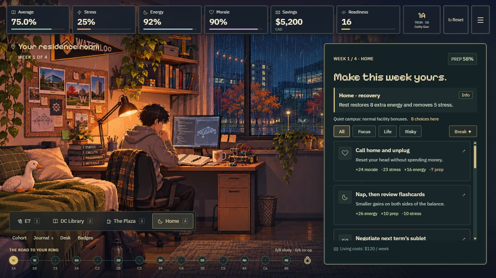

# Waterloo Engineering Life

**[Play Waterloo Engineering Life in your browser](https://4onv.github.io/uwaterloo-engineering-life-play/)**. The GitHub Pages edition autosaves on this browser and supports save-file export and import.

A full-screen, single-player 2D game about getting from Grade 12 admissions to a Waterloo engineering iron ring. Inspired by [Waterloo Eng Life on Chatforce](https://waterloo-eng-life.chatforce.com/?ref=dev), with an original implementation, dialogue, and generated background artwork.



The [TypeScript engine](src/engine.ts) runs the game in the browser after compilation to JavaScript. [Python generates the studio cards](tools/studios.py) and powers the [local SQLite save server](server.py). GitHub Actions runs the [Bash verification script](scripts/check-game.sh) before deploying to Pages.

## Play locally

Requires Node.js 24+ and Python 3.11+. Python has no third-party dependencies.

```sh
npm ci
npm run build
python server.py
```

Open **http://127.0.0.1:8790/**. Python serves the built game and stores three manual save slots in SQLite at `.data/saves.sqlite3`. On Windows with uv installed, `uv run --python 3.12 python server.py` works too.

For development, `npm run dev` serves **http://127.0.0.1:5173/** with rebuilds and live reload. Browser saves work without the Python server. The production build can also be hosted as a static site.

## The game

- Enter your name, spin for a Grade 12 average from **20.0% to 99.8%**, choose one of 14 engineering programs, and spin for admission. Ordinary odds can fall as low as **0.001%**.
- Play a complete campaign: eight study terms and six co-ops, arranged by stream 4 or 8. Each chapter compresses a term into four weekly decisions.
- Visit E7, Davis Centre, University Plaza/CPH, residence, and your co-op workplace. Each has its own illustrated full-screen scene.
- Draw three fresh action cards from a pool of **75 actions and 48 events**. Weekly actions, event responses, travel and shop purchases each have an outcome wheel. Within a location the next hand excludes the previous hand. Each of the 14 engineering disciplines adds a project in E7 and a study activity at DC. The program selector and journal link to Waterloo’s official program pages and show sample first-year courses. High-stakes actions have explicit risk probabilities and visible consequences. Preparation decays, expenses accumulate, and bad rolls can fail a prepared student.
- Locations are gameplay systems: E7 adds preparation/skill/stress, DC adds preparation at an energy cost, the Plaza adds connections and spending, home restores energy at a preparation cost, and work adds reputation and pressure. Travel costs energy; first arrivals can trigger an encounter without spending a week. Freezing rain raises travel costs, midterm crowds weaken DC, and career fairs double Plaza networking.
- Spin for finals, interview offers, and work-term reviews. Preparation, wellbeing, skills, and connections influence outcomes; there are no mandatory reflex tests.
- Choose among research, local engineering, Toronto, and California co-op roles. All offers are chance-based, including repeat applications.
- Pick one free arcade game per term, including Goose Crossing and the EngSoc Parts Swap. In week two, the pop-up arcade spins for a booth. Rewards are fictional game currency.
- Develop three friendships, buy six passive upgrades, and collect 15 permanent achievements.
- Reach graduation, a balanced-life ending, or the Cali-and-savings dream ending. **Two academic strikes force a transfer to AFM.** A co-op review below 45, burnout, or a balance below −$12,000 also ends the engineering run. Burnout limits are four in Cozy, three in Balanced, two in Crunch, and one in Devil.
- Use **Reset** at any time, including during a spin or open menu. It confirms before replacing your current run. Manual save slots and permanent achievements remain.
- Autosave after choices; use three manual slots and save-file import/export. Reduced motion and optional sound are in the game menu.

### Hidden name rules

Name comparison ignores case, surrounding whitespace, and repeated spaces.

- **Cathy** and **Cathy Guo** can apply to every program. Only a Mechatronics stream 8 application guarantees an offer at any mark. Mechatronics stream 4 and all other applications use their normal in-game odds.
- **Markus**: a **78.0%** Grade 12 average and the special result **“You only got into math.”** This ends that admissions run.
- **Terry**: forces **Devil difficulty**, even if Cozy was selected: $2,800 starting cash, 42 preparation, 1.7× positive stress, weaker gains, faster preparation decay, higher fees, tougher interviews, and one burnout recovery before the run ends. Existing Terry saves also load into Devil mode.

### Controls

Click or tap choices. Keys **1–5** travel between locations during weekly play. The **All / Focus / Life / Risky** filters organize location actions; **Break** opens the free term challenge. **Info** explains the facility bonus, cost, and arrival rules. **Escape** closes ordinary menus; focus stays inside dialogs. Reset remains available during locked outcome reveals. The game fills the browser viewport; no website header or footer surrounds it.

Animation includes walking during travel, action feedback, rain, snow, falling leaves, a roaming goose, and monitor activity. Reduced motion disables these effects. Text uses readable bundled IBM Plex Sans for stats and descriptions; pixel lettering is reserved mainly for headings.

## Development and validation

```sh
npm test
npm run build
python -m unittest discover -s python_tests -v
node --experimental-strip-types tools/simulate.ts --runs 1000 --output balance-report.json
python tools/balance.py balance-report.json --check
```

The TypeScript campaign simulator runs the actual game engine with seeded random choices. The Python analyzer reports graduation rates, average grades, savings, and California placements, with a Wilson confidence interval and balance regression guardrails. Bot simulations do not replace human playtesting.

GitHub Actions runs the engine tests, production build, Python server tests, and balance guardrails, then uploads a browser build artifact.

## Structure

| Path | Purpose |
| --- | --- |
| `src/engine.ts` | Seeded game rules, admissions, actions, term progression, saves |
| `src/data.ts`, `src/expansion.ts` | 14 programs, 75 actions, 48 events, facility rules, jobs, upgrades, friendships |
| `src/main.ts` | Game screens, accessible dialogs, audio, save/load controls |
| `src/art-scene.ts` | Full-screen canvas scenery, transitions, ambient animation |
| `src/chance.ts`, `src/arcade.ts` | Animated outcome wheels and six chance minigames |
| `src/game.css`, `src/expansion.css` | Full-screen HUD, readable typography, action filters, and responsive menus |
| `server.py` | Standard-library Python HTTP server and SQLite save API |
| `tools/studios.py` | Authors the 28 discipline-specific project and study cards; run it after editing the catalog |
| `scripts/check-game.sh` | Verifies card generation, builds the game, runs both test suites and checks campaign balance |
| `public/art/` | Five original AI-generated pixel-art backgrounds |
| `tests/`, `python_tests/` | Engine invariants, hidden names, save validation, API checks |

## Save API

The optional Python server binds to loopback only.

| Method | Path | Behavior |
| --- | --- | --- |
| GET | `/api/health` | Service/version/storage information |
| GET | `/api/saves` | Read saved slots keyed `1`–`3` |
| PUT | `/api/saves/1` (or `2`, `3`) | Store `{ "savedAt": "ISO timestamp", "state": {...} }` |

Writes require JSON and a valid local origin; payloads are bounded and validated. Browser imports get additional engine validation. Saves contain the random generator state so reloading preserves future outcomes.

## Attribution and scope

This is an **unofficial fan game**. It is not affiliated with the University of Waterloo, EngSoc, or Chatforce. Program names and stream categories reference [Waterloo’s co-op information](https://uwaterloo.ca/engineering/undergraduate-students/co-op-experience/co-op-study-sequences); campus traditions reference [EngSoc](https://www.engsoc.uwaterloo.ca/about-us/traditions/). Sequences are simplified for the game. Admissions odds, grades, fees, salaries, academic rules, characters, and geography are fictionalized. The iron ring is used as a story milestone, not a professional licence.

No source code, dialogue, screenshots, sprites, or music were copied from the reference game. Backgrounds were generated with OpenAI’s built-in image generator; see [ART.md](ART.md). Fonts are bundled locally from Fontsource under their included OFL licences. There are no accounts, analytics, real-money transactions, or external runtime dependencies.
